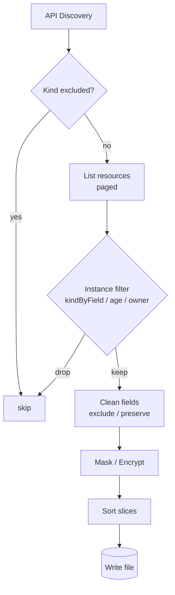
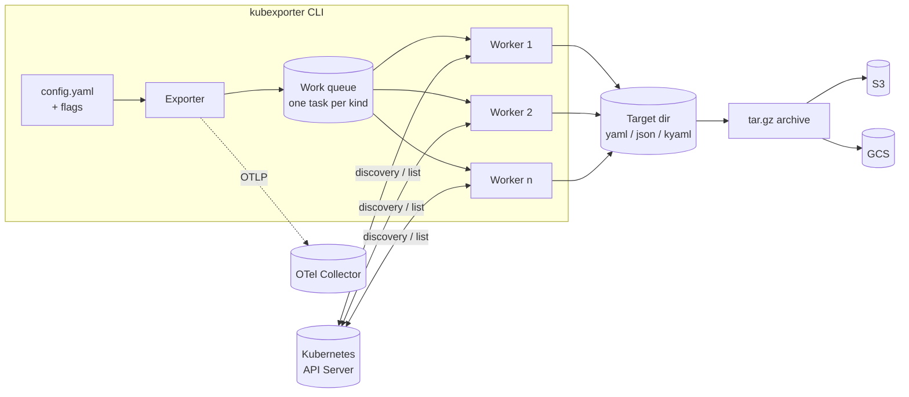
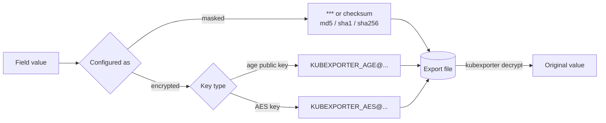
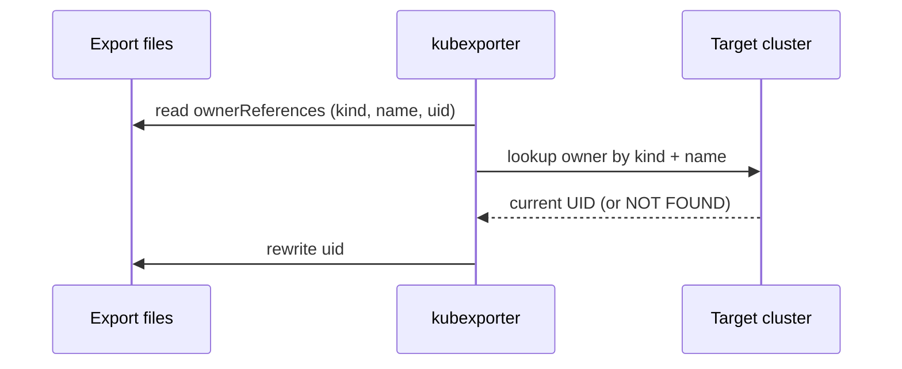
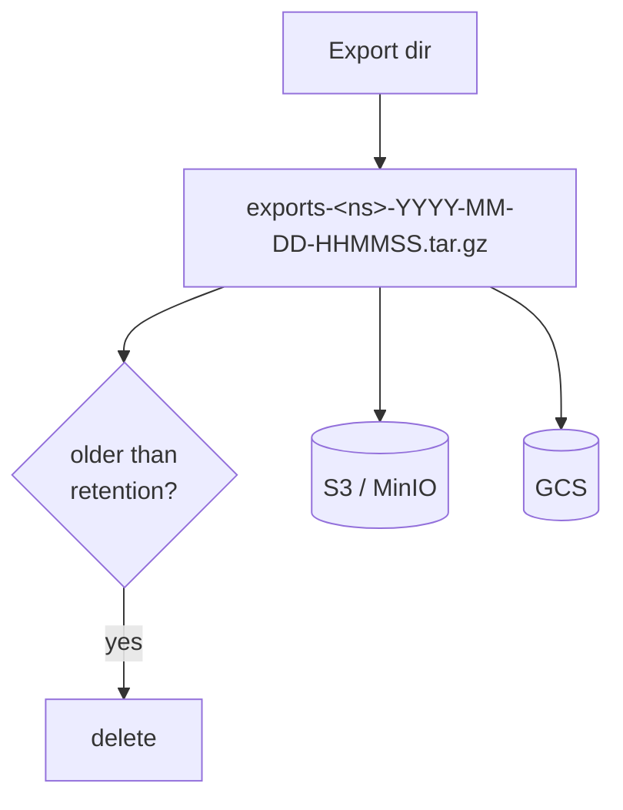

<!-- jump_to_middle -->

<!-- alignment: center -->


Run: `devbox run k-present` (uses the kind cluster `kubexporter-demo` from `setup/setup.sh`)

---

Why KubExporter?
===

<!-- incremental_lists: true -->

* **Backup / Disaster Recovery** – a plain-file snapshot of *every* resource in a cluster
* **Audit & Diff** – compare clusters or the same cluster over time
* **Migration** – move workloads between clusters / providers
* **Debugging** – grab the full state of a namespace for offline analysis
* **Manifest extraction** – turn hand-made cluster state into reusable manifests

<!-- pause -->

Output is just files: keep them on disk, in a tar.gz, in S3 / GCS – or in Git, if that fits your workflow.

<!-- pause -->

> `kubectl get -o yaml` gives you *noisy* output for *one* kind.
> KubExporter gives you *clean* output for *all* kinds – including CRDs.

---

Key Idea: exclude, don't include
===

<!-- column_layout: [1, 1] -->

<!-- column: 0 -->

### Opt-out by default

* Discovers **all** API resources via the discovery API
* New CRDs are exported **automatically**
* You only say what you **don't** want

<!-- pause -->

### Clean output

* Strip runtime noise: `status`, `uid`, `resourceVersion`, `managedFields`, …
* Deterministic file names & sorted slices → **diff-friendly**

<!-- column: 1 -->



<!-- reset_layout -->

---

Getting Started
===

```bash
# Release binaries
https://github.com/bakito/kubexporter/releases

# Homebrew
brew tap bakito/tap && brew install --cask kubexporter

# kubectl plugin (krew)
kubectl krew install exporter
kubectl exporter --help
```

<!-- pause -->

Uses your **kubeconfig** – all the usual flags work: `--context`, `--as`, `--token`, `--server`, …

```bash +exec +pty:120:9
kubexporter --version
kubexporter --help | sed -n '/Available Commands/,/^$/p'
```

---

Architecture
===



* `-w / --worker` → parallel workers (one kind per task)
* `queryPageSize` → paged list requests for large clusters

---

Live Demo: first export
===

`demo-config.yaml` limits the export to `kubexporter-test` and `kube-system` of the kind cluster `kubexporter-demo` (kinds without instances are filtered from the summary):

```bash +exec +pty:150:40
cd "${DEVBOX_PROJECT_ROOT}/kubexporter"
kubexporter --config demo-config.yaml | grep -vE ' yes +0 +0 '
```

---

Clean, diff-friendly manifests
===

### Global & per-kind field excludes

```yaml
excluded:
  fields:
    - [status]
    - [metadata, uid]
    - [metadata, resourceVersion]
    - [metadata, managedFields]
  kindFields:
    Service:
      - [spec, clusterIP]
      - [spec, clusterIPs]
  preservedFields:
    fields:
      - [status, loadBalancer, ingress]
```

`preservedFields` → keep a child even if the parent is removed.

### Result

```bash +exec +pty:200:10
bat /tmp/kubexporter-demo/exports/kube-system/Service.kube-dns.yaml
```

<!-- reset_layout -->

---

Filtering resources
===

| What               | Config                          | Flag                          |
|--------------------|---------------------------------|-------------------------------|
| Exclude kinds      | `excluded.kinds`                | `-e, --exclude-kinds`         |
| Sane default excl. | –                               | `-d, --exclude-defaults`      |
| Include only kinds | `included.kinds`                | `-i, --include-kinds`         |
| Namespaces         | `namespace` / `namespaces`      | `-n, --namespace`             |
| + cluster scoped   | `includeClusterResources`       | `--include-cluster-resources` |
| By field value     | `excluded.kindByField`          | –                             |
| By age             | `createdWithin`                 | `--created-within 24h`        |
| By owner           | `considerOwnerReferences`       | –                             |

<!-- pause -->

```yaml
excluded:
  kindByField:
    Secret:                       # drop Helm release secrets
      - field: [type]
        values: ['helm.sh/release.v1']
considerOwnerReferences: true     # skip resources whose owner is exported
```

---

Ad-hoc export with flags only
===

No config file needed – quick "what changed today?" snapshot:

```bash +exec +pty:120:30
kubexporter -n kube-system -i ConfigMap,ServiceAccount \
  -t /tmp/kubexporter-demo/adhoc -c -p none --summary \
  --created-within 8760h
```

<!-- pause -->

```bash +exec +pty:120:7
ls -1 /tmp/kubexporter-demo/adhoc/kube-system | head -n 6
```

---

Protecting sensitive data
===



* **Masking** – one-way: still lets you *detect changes* via checksum, never restore
* **Encryption** – reversible: exports can be stored or shared safely, restore when needed
* **age is preferred** over AES when both keys are configured

---

Encryption in the export
===

```yaml
encrypted:
  aesKey: "12345678901234567890123456789012"   # or KUBEXPORTER_AES_KEY / K8s Secret
  # agePublicKey: "age1..."                     # preferred: public-key crypto
  kindFields:
    Secret:
      - [data]
      - [stringData]
```

<!-- pause -->

```bash +exec +pty:120:19
cut -c1-80 /tmp/kubexporter-demo/exports/kubexporter-test/Secret.kubexporter-secret.yaml | bat -l yaml
```

---

Decrypt (AES)
===

```bash +exec +pty:120:23
cp /tmp/kubexporter-demo/exports/kubexporter-test/Secret.kubexporter-secret.yaml /tmp/kubexporter-demo/secret.yaml
kubexporter decrypt --aes-key 12345678901234567890123456789012 /tmp/kubexporter-demo/secret.yaml
cut -c1-80 /tmp/kubexporter-demo/secret.yaml | bat -l yaml
```

<!-- pause -->

Keys can come from:

* flag `--aes-key` / env `KUBEXPORTER_AES_KEY` / interactive password prompt
* a Kubernetes Secret: `--aes-key-secret-namespace|name|key`

---

Encrypt & Decrypt with age
===

Encrypt existing files after the fact – only the recipient's **public** key is needed:

```bash +exec +pty:120:12
cd /tmp/kubexporter-demo
rm -f age.key && age-keygen -o age.key 2>/dev/null
PUB=$(age-keygen -y age.key)
kubexporter encrypt --age-public-key "$PUB" secret.yaml
cut -c1-80 secret.yaml | sed -n '2,4p' | bat -l yaml
```

<!-- pause -->

```bash +exec +pty:120:6
cd /tmp/kubexporter-demo
kubexporter decrypt --age-identity "$(grep AGE-SECRET-KEY age.key)" secret.yaml
```

> Mixed files (AES **and** age values) are decrypted in a single pass.

---

Update Owner References
===

UIDs change when resources are re-created in another cluster → `ownerReferences` break.



```bash
kubexporter update-owner-references
 FILE                                    OWNER KIND  OWNER NAME  UID FROM   UID TO
 kubexporter-test/apps.Deployment.…     Deployment  kubexp…    1d49…hhhh  1d49…db54
```

---

Archives & Remote Storage
===

<!-- column_layout: [1, 1] -->

<!-- column: 0 -->

```yaml
archive: true            # -a
archiveTarget: /backups
archiveRetentionDays: 10 # rotate old archives

s3:
  endpoint: minio.local:9000
  accessKeyID: ...
  secretAccessKey: ...
  secure: true
  bucket: k8s-backups

gcs:
  bucket: k8s-backups    # auth via ADC / Workload Identity
```

<!-- column: 1 -->



<!-- reset_layout -->

---

Run it as a CronJob
===

```yaml {all|7-8|10-13|14-16}
apiVersion: batch/v1
kind: CronJob
metadata:
  name: kubexporter
spec:
  schedule: "0 2 * * *"
  jobTemplate:
    spec:
      template:
        spec:
          serviceAccountName: kubexporter   # ClusterRole: get/list on *
          containers:
            - name: kubexporter
              image: ghcr.io/bakito/kubexporter:latest
              args: ["--config", "/config/config.yaml", "-p", "none", "--summary"]
              envFrom: [{ secretRef: { name: kubexporter-keys } }]
          restartPolicy: OnFailure
```

* Image is published to `ghcr.io` and signed with **cosign**
* Encrypt with **age**: the Job only needs the *public* key
* Push archives to S3 / GCS and use `archiveRetentionDays` for rotation

---

Observability for SREs
===

<!-- column_layout: [1, 1] -->

<!-- column: 0 -->

```yaml
metrics:
  otlp:
    enabled: true     # --otlp-metrics
    endpoint: otel-collector:4317
    insecure: true
```

Auth headers via env:

```bash
KUBEXPORTER_METRICS_OTLP_HEADER_Authorization="Bearer <token>"
```

Grafana dashboard: `examples/grafana/dashboard.json`

<!-- column: 1 -->

| Metric                                |
|---------------------------------------|
| `kubexporter.duration_seconds`        |
| `kubexporter.errors`                  |
| `kubexporter.exported_resources`      |
| `kubexporter.exported_size_bytes`     |
| `kubexporter.namespaces`              |
| `kubexporter.resource.instances`      |
| `kubexporter.resource.query_duration_seconds` |
| `kubexporter.resource.export_duration_seconds` |

<!-- reset_layout -->

> Alert on `errors > 0` or a missing run → your backup is silently broken.

---

UX: progress & summary
===

| Mode      | Use case                       |
|-----------|--------------------------------|
| `bar`     | default, interactive terminal  |
| `bubbles` | fancy TUI (bubbletea)          |
| `simple`  | CI logs                        |
| `none`    | CronJobs / scripting           |

* `--summary` → table per kind: instances, exported, query & export duration
* `--size` → size of the exported files
* `-v / --verbose` → list errors in summary, `-q / --quiet` → no output

```bash +exec +pty:120:30
kubexporter -n kubexporter-test -i ConfigMap,Secret -t /tmp/kubexporter-demo/ux -c \
  -p simple --summary --size 2>&1
```

---

Live Demo: progress bar
===

The `bar` and `bubbles` modes need a real, interactive terminal.

`+acquire_terminal` gives the snippet the whole terminal. Press `ctrl+e` to run it, and press any key to go back to the slides.

```bash +exec +acquire_terminal
clear
cd "${DEVBOX_PROJECT_ROOT}/kubexporter"
kubexporter --config demo-config.yaml -p bar --summary=false
echo
read -n 1 -s -r -p "Press any key to return to the presentation..."
```

<!-- pause -->

```bash +exec +acquire_terminal
clear
cd "${DEVBOX_PROJECT_ROOT}/kubexporter"
kubexporter --config demo-config.yaml -p bubbles --summary=false
echo
read -n 1 -s -r -p "Press any key to return to the presentation..."
```

---

Use case: diff two snapshots
===

```bash +exec +pty:120:5
cd /tmp/kubexporter-demo
kubexporter -n kube-system -i ConfigMap -t snap1 -c -q
kubectl -n kube-system create configmap kubexporter-demo --from-literal=hello=world >/dev/null
kubexporter -n kube-system -i ConfigMap -t snap2 -c -q
diff -r snap1 snap2
kubectl -n kube-system delete configmap kubexporter-demo >/dev/null
```

<!-- pause -->

Clean fields + deterministic names + `sortSlices` = **only real changes show up**.

---

Recap
===

<!-- incremental_lists: true -->

* Export **all** resources (incl. CRDs) – opt-out filtering
* Clean, deterministic, **diff-friendly** YAML / JSON / kyaml
* Fine-grained filters: kinds, namespaces, field values, age, owners
* **Mask** or **encrypt** (AES / age) sensitive fields – decrypt later
* Fix `ownerReferences` against a new cluster
* Archives with retention, upload to **S3 / GCS**
* **OTLP metrics** + Grafana dashboard for SREs
* Works as standalone binary, **kubectl plugin**, or **CronJob**

<!-- pause -->

<!-- alignment: center -->

**Try it:** https://killercoda.com/bakito/scenario/kubernetes-kubexporter

**Code:** https://github.com/bakito/kubexporter
