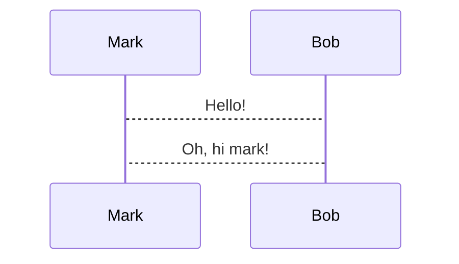

<!-- newlines: 16 -->


kubexporter - (kubernetes) Backup better. Together.
====

<!-- alignment: center -->

<span style="color: blue">Raphael Müller / Marc Brugger</span>
<!-- end_slide -->

Running kubexporter to export your kubernetes resources:

<!-- incremental_lists: true -->
* parallel export worker
* different progress formats
* s3 / google storage bucket support
* secret masking or encryption
* otlp metrics
* owner reference migration
<!-- incremental_lists: false -->

(Press `ctrl + e` to execute)

```bash +exec +pty:80:30
kubexporter -w 5 --progress simple
```

<!-- end_slide -->
---



