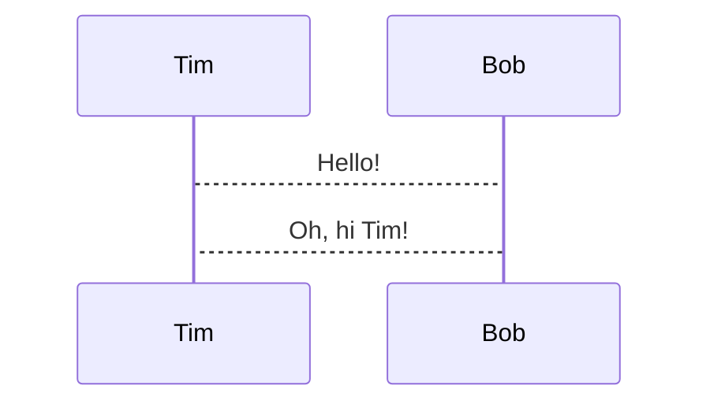

---
theme:
  override:
    footer:
      style: template
      left: '**DevCon Lozärn 23.10.2026**'
      height: 3
    palette:
      classes:
        noice:
          foreground: red
---

<!-- newlines: 5 -->


KubExporter  
(kubernetes) Backup better. Together.
====

<!-- alignment: center -->

<span style="color: #2e6ce6">Raphael Müller / Concordia &nbsp;&nbsp; Marc Brugger / Bison Group</span>
<!-- end_slide -->

# Origin

<!-- incremental_lists: true -->

* Community product based on Ruby was used to backup kubernetes resources
    * All resources needed explicitly be defined in config - otherwise they were not backupped
    * Export took of one cluster took mor than one hour
    * After introducing a new CRD to the cluster they got not added to the config -> we had no backups when we needed them

<!-- incremental_lists: false -->


<!-- incremental_lists: true -->

* Decision to implement a new backup tool in Go
    * Opt-Out instead of Opt-In (All resources are included by default)
    * Export duration reduced to < 30s
    * Runs as CronJob -> No permanent resources needed
    * Export to git -> complete history available

<!-- incremental_lists: false -->

<!-- end_slide -->

# Why OpenSource

<!-- incremental_lists: true -->

* Most of the time invested in private outside the company
* OpenSource -> community driven development
* New features are requested/added by the community
* Accessible for everyone
    * Apache 2.0 License
* Integration in existing Package/Plugin managers
    * ❄️ nix
    * 🍺 brew
    * 🔌 krew (kubectl plugin)

<!-- incremental_lists: false -->

<!-- end_slide -->

# Features

<!-- incremental_lists: true -->

* 🗲 parallel export worker
* 📊 different progress formats
* ☁️ s3 / google storage bucket support
* 🔐 secret masking or encryption (age/AES)
* 📈 otlp metrics
* 🔄 owner reference migration (re-import with updated owner references)

<!-- incremental_lists: false -->

<!-- end_slide -->

# How / when add new features?

<!-- incremental_lists: true -->

* ☁️ s3 / google storage bucket support
    * Moving to cloud, where git was not an option
* 🔐 Secret masking or encryption
    * Working with git, it is not safe to commit content of secrets
* 📈 otlp metrics
    * Regression after implementing multi-namespace selection. KubExporter terminated without error, but did not export
      anything -> Having metrics, we can setup alerts, based on the metrics.
* 🔄 owner reference migration
    * Resources imported in a cluster where owning resources got re-created (new UUID) got deleted due to invalid owner
      reference

<!-- incremental_lists: false -->


<!-- end_slide -->

# Demo

(Press `ctrl + e` to execute)

```bash +exec +acquire_terminal
clear
cd "${DEVBOX_PROJECT_ROOT}/kubexporter"
kubexporter --config demo-config.yaml -p bar --summary=false
echo
read -n 1 -s -r -p "Press any key to return to the presentation..."
```

<!-- end_slide -->

# Demo otel (OpenTelemetry) Metrics

If configures, metrics will be pushed to the otel collector if the sync is finished.
<!-- alignment: center -->

| Metric                                       | Description                                        |
|----------------------------------------------|----------------------------------------------------|
| kubexporter.duration_seconds                 | Total export duration in seconds                   |
| kubexporter.errors                           | Number of errors encountered during export         |
| kubexporter.exported_resources               | Total number of exported resources                 |
| kubexporter.exported_size_bytes              | Total size of exported resources in bytes          |
| kubexporter.kinds                            | Number of kinds processed                          |
| kubexporter.namespaces                       | Number of namespaces containing exported resources |
| kubexporter.query_pages                      | Total number of query pages requested              |
| kubexporter.resource.export_duration_seconds | Export duration per kind in seconds                |
| kubexporter.resource.exported_instances      | Number of exported resource instances per kind     |
| kubexporter.resource.exported_size_bytes     | Size of exported resources per kind in bytes       |
| kubexporter.resource.instances               | Number of resource instances found per kind        |
| kubexporter.resource.query_duration_seconds  | Query duration per kind in seconds                 |
| kubexporter.resource.query_pages             | Number of query pages per kind                     |

<!-- newlines: 2 -->

```bash +exec +pty:150:30
kubectl logs -l app=otel-collector -n otel --tail=-1 | grep exported.instances
```

<!-- end_slide -->
---



